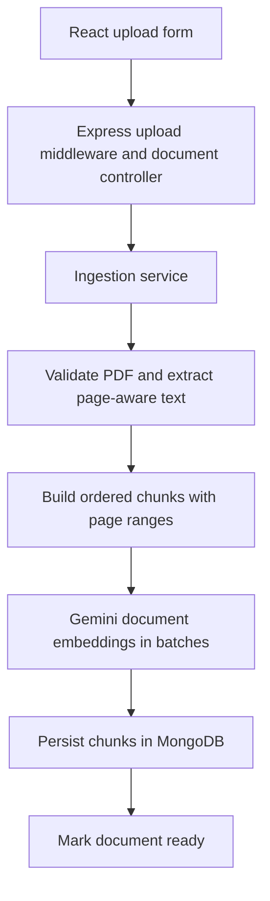
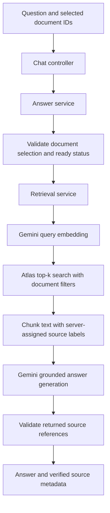

# Architecture

Last updated: 2026-11-17. This is the initial design, not a description of a completed application.

## Scope and sources

The primary scope reference is `../MERN_to_AI_Roadmap.pdf`, Phase 2, pages 8-9. Additional project requirements and learning instructions are in `../MASTER_PROMPT.md`.

The PDF explicitly specifies PDF upload, chunking and embedding storage, top-k retrieval, context-augmented answers, and chunk/page citations. Multiple-document support is its stretch goal. Learning topics include cosine similarity, chunking strategies, vector databases, hybrid search, reranking, and evaluation.

The master prompt additionally requires Gemini through the official SDK, MongoDB Atlas Vector Search, secure ingestion, processing status, source verification, insufficient-evidence handling, multiple-document support, and evaluation. Agent frameworks, autonomous agents, and later roadmap phases are outside scope.

## Target structure

Build the application entirely from scratch. Do not reuse or consult the previous implementation as reference. The structure below is the planned application layout; client and server code will be created progressively in Guided Implementation Mode.

```text
client/                         React + Vite + strict TypeScript
server/src/
  config/                       Validated environment configuration
  common/                       Shared errors and justified utilities
  modules/documents/            Uploads, ingestion, document/chunk persistence
  modules/retrieval/            Query embeddings and Atlas vector search
  modules/chat/                 Answer orchestration and citation verification
  providers/gemini/             Official SDK integration
docs/                           Architecture, decisions, plan, learning progress
```

One repository keeps frontend/backend changes together. HTTP controllers handle request/response concerns; services coordinate business operations; repositories encapsulate persistence; provider adapters isolate SDK details. Avoid abstractions without a practical need.

## Data flows



Upload middleware enforces file-size limits. File signatures must be checked in addition to supplied MIME types. Create a `processing` document after initial validation, enforce page-count limits during extraction, and mark it `ready` only after all required chunks are stored. The ingestion service coordinates persistence of `failed` status when processing fails. Partially stored chunks must remain excluded from retrieval. Cleanup, retry mechanics, and consistency enforcement remain to be designed.

Image-only PDFs should receive a clear explanation when no usable text can be extracted. OCR is a separate scope decision. Processing during the upload request was proposed as an initial approach; background processing and timeout implications remain open.



The answer service coordinates the pipeline; retrieval owns query embedding and search. Documents and questions must use a compatible embedding model/configuration. Matching vector dimensions alone is insufficient.

## Initial data model

These fields were discussed and reviewed as a learning model; they are not implemented schemas. String identifiers were used in the exercise. Concrete MongoDB identifier types remain open.

| Collection | Fields | Meaning |
| --- | --- | --- |
| documents | `_id`, `originalFilename`, `status`, optional `pageCount`, `createdAt` | Uploaded PDF and processing lifecycle |
| chunks | `_id`, `documentId`, `chunkIndex`, `text`, `pageStart`, `pageEnd`, `embedding` | Searchable passage and its evidence location |

- `status`: `processing`, `ready`, or `failed`.
- `createdAt`: a date. `pageCount` may be unknown before extraction finishes.
- `chunkIndex`: zero-based position within one document, not a page number.
- `pageStart` and `pageEnd`: required positive integers using one-based physical PDF pages, with `pageStart <= pageEnd <= pageCount` when the page count is known. Printed page labels may differ.
- `embedding`: a numeric vector. Store the original text because the vector is used to locate evidence, not reconstruct it.
- Preserve page boundaries during extraction and chunking. Chunks may share pages or span pages.
- Record embedding model and dimension metadata to detect incompatible vectors; exact placement and index strategy remain open.

## Grounding, citations, and errors

Top-k search ranks available matches; it does not prove relevance or answer support. Insufficient supporting evidence should produce an explicit unsupported-answer response.

Supply original chunk text with server-assigned labels such as `S1`. Resolve labels to retrieved chunk/document/page metadata on the server. Unknown labels must never be mapped to invented sources. Reject a generated answer containing an unknown reference rather than merely removing the reference and leaving an unverified claim. A bounded regeneration attempt is a future option.

Reference validity and claim support are separate checks: a known source label can still accompany an unsupported claim. The exact claim-support and insufficient-evidence mechanisms require further design and evaluation.

Database/provider failures and invalid generated references are operational failures, distinct from an evidence-based conclusion that the documents do not support an answer. Centralized error handling must preserve that distinction and avoid exposing secrets.

## Stack and unresolved choices

The approved target is React, Vite, strict TypeScript, Tailwind CSS v4, Express, Zod, MongoDB Atlas with cosine vector search, and Gemini through `@google/genai`. Add frontend libraries from the master prompt where their use is justified.

Before implementation, verify current Gemini models, SDK APIs, dimensions, and task settings against official documentation. Prefer 768 dimensions if supported; no model availability or quota has been verified in this session.

Still to decide: MongoDB driver versus Mongoose, PDF parser, multipart library, upload execution/storage strategy, runtime schemas, embedding metadata placement, chunk sizing/overlap, batching/retries/timeouts, vector index definition, API response contracts, and grounding evaluation. Authentication is not an initial milestone; access isolation is required when accounts are introduced.
